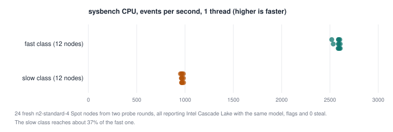

# Chaos Day Summary

Our daily load test had a puzzling pattern: the same test, on the same build, with the same configuration, sometimes ran clean and sometimes got stuck at 40 to 50% rejected requests (tracked in [camunda/camunda#68316](https://github.com/camunda/camunda/issues/68316)). Several things contributed. This chaos day focuses on one of them, because it can affect other workloads too: **GKE `n2` machines come in a fast and a slow class**.

**TL;DR;** Fresh GKE `n2` nodes without a minimum CPU platform come in a fast and a slow class. Both report the same CPU model, flags, and platform, and no steal time. The slow class reaches roughly 37% of the speed in a `sysbench` CPU benchmark. Google confirmed that the platform assignment is automatic and depends on availability, so which node you get is effectively random. Pinning the pool to Ice Lake with `min_cpu_platform` removed the slow class in every probe we ran.

<!--truncate-->

## Chaos Experiment

We did not inject a fault here. The "experiment" was a systematic comparison: identical clusters, identical build, then differences in the cluster, the pods, and the nodes.

### Expected

Identical clusters should deliver identical throughput within a few percent. A cluster that sits at 40 to 50% rejected requests should have an event in its window, such as a restart or a leader change, or a configuration difference.

### Actual

#### Ruling things out, cheapest first

We worked through the same order every time, and it is worth keeping:

1. **Cluster level.** Backpressure (dropped requests against received requests), CPU throttling per broker, processing latency. A pod with CPU request equal to limit can throttle and then looks like slow code.
2. **Events in the window.** Pod replacement, restart, leader change. After a failover one broker carries extra partitions and saturates, so the window is disturbed even though the hosts are fine.
3. **Configuration.** The Helm values, node pool labels, and image tag against a good cluster.
4. **Per broker.** Partitions led by the slowest broker rejected about 50% of their requests, partitions led by the other brokers about 22%.
5. **The host.** CPU model, clock, a CPU benchmark, steal time.

The first four steps explained some runs, but not all of them. The slow broker had no event and a normal configuration, so we looked at the node.

#### Two classes of the same machine

We ran `sysbench` on fresh, idle `n2-standard-4` nodes and found two distinct classes. The slow class also showed up on idle on-demand nodes of our stable pool, so it is not specific to Spot. The figure below shows 18 fresh nodes from two probe rounds, the table the 12 nodes we checked in detail.

| | Fast class | Slow class |
|---|---|---|
| `sysbench` CPU events | 2568 to 2599 | 967 to 975 |
| `cpu MHz` in `/proc/cpuinfo` | exactly 2799.998 | 2800.19 to 2800.33 |
| CPU model and flags in the guest | identical | identical |
| CPU platform reported by GCE | `Intel Cascade Lake` | `Intel Cascade Lake` |
| Steal time | 0 | 0 |

The slow class reached about 37% of the fast one in the `sysbench` CPU benchmark and about 70% in the memory benchmark. A `stress-ng` CPU run showed no difference, so the effect depends on the instruction mix and the benchmark you pick matters.

Two things stand out:

- **Steal time stays 0.** A clean steal does not clear a host. The hypervisor does not report the difference.
- **The only visible hint is the clock value.** The slow nodes report a `cpu MHz` that is slightly above 2800, while the fast ones report exactly 2799.998. That is a cheap detector for fresh `n2` nodes:

```bash
grep -m1 'cpu MHz' /proc/cpuinfo
```

On the 12 fresh nodes we checked in detail, 5 were fast and 7 were slow. A scan of 57 brokers in our running clusters found 44% with the slow-class `cpu MHz` value, which is a correlation from one snapshot. Pinning five clusters to the one zone that had looked clean did not help: 0 of 5 recovered, and 4 of 5 had a slow node. An AMD `c3d` pool showed no slow class in 6 nodes.



#### Why does this happen?

The Google documentation lists two CPU platforms for `n2`: Cascade Lake and Ice Lake. By default Cascade Lake is used up to 80 vCPUs. We asked Google, and they confirmed that without `min_cpu_platform` the setting stays `AUTOMATIC`, which gives Cascade Lake if it is available in the zone, and that the assignment depends on availability. Google's answer covers the assignment. Why two performance classes both report Cascade Lake is not explained, and we did not find out. What we know is that pinning Ice Lake removed the slow class in every probe.

With `min_cpu_platform` set to Ice Lake, all 14 probes of a test pool were in the fast class. The `cpu MHz` reads about 2600.0, nothing like the other values, the platform is reported as Ice Lake, and `sysbench` reached 2502 to 2613 events, close to the fast Cascade Lake nodes.

We pinned all our `n2` node pools to Ice Lake on 2026-11-10. A node benchmark over all live nodes afterwards found no slow class.

Note that the `cpu MHz` detector is specific to Cascade Lake pools. On an Ice Lake pool, the value is about 2600 and the check does not separate classes.

#### What we could not explain

After the pin, one cluster was still about 10% less efficient per CPU-second with 28% CPU throttling, with no event in its window and a normal CPU model, steal and heap. Its nodes were gone when we checked, so we could not run a node benchmark. In another verification cluster, a single broker was slow for hours and recovered on its own. It was a single sample each time and we could not prove a cause. Our best guess is noisy neighbors, which is suspected but not proven. The evidence is gone unless it is captured during the phase, so if it shows up again, capture a node benchmark, steal, and CPU pressure right then.

## Conclusion

Identical clusters are only identical if the hosts are. A fresh GKE `n2` node can be fast or slow with the same CPU model, flags, and platform reported. It is one of the causes behind our stuck daily runs: the slow hosts explain the spread between brokers, while other parts of the test setup explain the rest.

- Set `min_cpu_platform` for `n2` pools, or benchmark a sample of fresh nodes before you trust numbers from a new pool, zone, or machine type.
- Pinning needs a node pool re-create and can reduce the zone capacity, so plan for it.
- Check the cheap things first: backpressure, throttling, events, configuration, then the host.

We only measured `n2-standard-4` and `n2-standard-8` in one region, and the effect depends on the workload, but any CPU-bound workload on `n2` nodes without `min_cpu_platform`, such as a Kubernetes cluster created with default settings, can land on the slow class and see the same unexplained difference between identical deployments.

## Found Bugs and Follow-ups

- [camunda/camunda#68316](https://github.com/camunda/camunda/issues/68316): the parent issue of the investigation.
